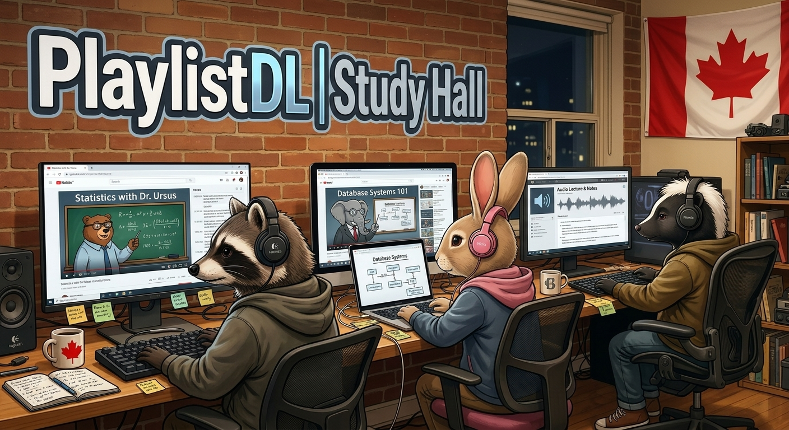
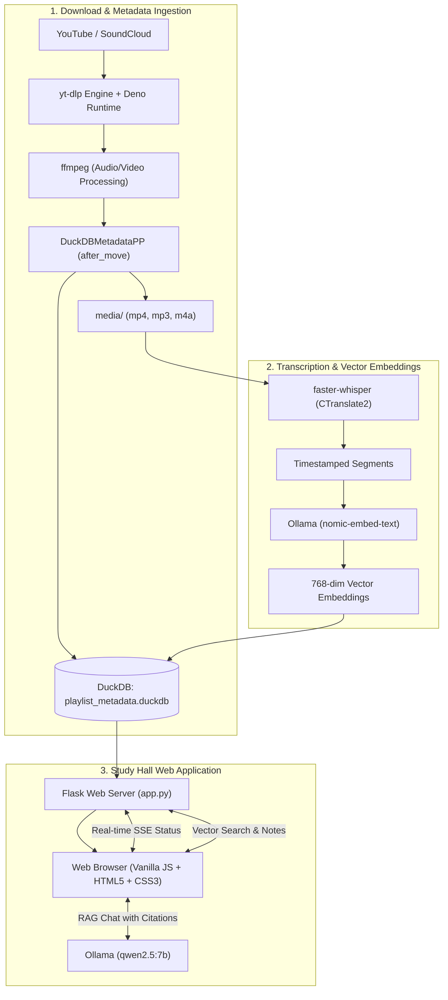

# PlaylistDL | Study Hall

[](https://www.gnu.org/licenses/gpl-3.0.html)
[](https://www.python.org/)
[](https://github.com/astral-sh/uv)
[](https://ollama.com/)
[](https://duckdb.org/)

**PlaylistDL | Study Hall** is an all-in-one local media archiver, lecture study hall, and AI research assistant. It downloads audio and video playlists from YouTube and SoundCloud, extracts comprehensive metadata into DuckDB, transcribes recordings locally with `faster-whisper`, generates vector embeddings via Ollama, and delivers a modern web study interface featuring interactive playback, timestamped note-taking, semantic search, and an AI study tutor with clickable video timestamp jumps.

---

## Table of Contents

- [Key Features](#key-features)
- [Architecture & Tech Stack](#architecture--tech-stack)
- [Quick Start (Automated Installer)](#quick-start-automated-installer)
- [Manual Installation](#manual-installation)
- [Usage Guide](#usage-guide)
  - [1. Web Study Hall & In-Browser Downloader](#1-web-study-hall--in-browser-downloader)
  - [2. CLI Playlist Downloader](#2-cli-playlist-downloader)
  - [3. Speech Transcription & AI Embeddings](#3-speech-transcription--ai-embeddings)
  - [4. Database Maintenance & Cleanup](#4-database-maintenance--cleanup)
  - [5. Desktop Rofi GUI Launcher](#5-desktop-rofi-gui-launcher)
- [Configuration (.env)](#configuration-env)
- [Cookie Setup & Best Practices](#cookie-setup--best-practices)
- [License](#license)

---

## Key Features

### 🎓 Modern Study Hall Web Interface
- **Distraction-Free Landing**: Displays the branded Study Hall visual when no playlist is active; reveals the player and tools when a course or playlist is selected.
- **Slide-Out Navigation Drawer**: A dedicated menu toggle keeps playlist selection, download modals, and database maintenance separated from the active study workspace.
- **Plugin-Free In-Browser Playback**: Universal native playback for video and audio (`.mp4`, `.mp3`, `.m4a`) across modern browsers.
- **Smart Collapsible Metadata**: Core track information (title, channel, duration, playlist) is shown upfront, while extensive technical metadata (format, bitrate, extractor, URLs) is tucked into clean collapsible cards.
- **Persistent Playback Memory**: Automatically remembers and restores your last-played track and exact timestamp.

### 📥 Built-in Web & CLI Downloader
- **In-Browser Modal**: Initiate single-track or full-playlist downloads directly from the web navbar or drawer menu.
- **Real-Time Progress Streaming**: Server-Sent Events (SSE) display live percentage, speed, ETA, and track counters (`Item X of Y`).
- **SoundCloud Rate-Limit (HTTP 429) Resiliency**: Built-in exponential backoff retries, request interval pacing, and bypass of redundant playlist pre-extraction calls.
- **Safe Media Post-Processing (`DuckDBMetadataPP`)**: Tracks final media file paths (`.mp3` / `.m4a`) at post-processing (`when='after_move'`), preventing broken database references and protecting converted files from cleanup purges.
- **Optional Auto-Transcription**: Checkbox to automatically trigger Whisper transcription immediately when a download completes.

### 🤖 Local AI Study Assistant (RAG Chat)
- **Chat with Your Playlist**: Converse with a local AI assistant powered by Ollama (`qwen2.5:7b`).
- **Retrieval-Augmented Generation (RAG)**: The assistant automatically pulls the most semantically relevant transcript excerpts from the active playlist to answer questions accurately.
- **Clickable Timestamp Citations**: Responses include interactive timestamp badges (e.g. `[14:23]`) that jump the media player straight to that moment when clicked.

### 🔍 Semantic Vector Search & Transcripts
- **Natural Language Search**: Search by concepts, ideas, or topics rather than just exact keywords using 768-dimensional Ollama embeddings (`nomic-embed-text`).
- **Interactive Transcript Tab**: Full, timestamped transcript segments for every lecture. Clicking any segment or timestamp immediately seeks the media player to that exact second.

### 📝 Synchronized Note-Taking
- **Timestamped Lecture Notes**: Take markdown notes while studying.
- **One-Click Timestamp Insertion**: Click **Insert Timestamp** to anchor your notes to the current video playback position.
- **DuckDB Persistence**: Notes are automatically saved per track and playlist in DuckDB.

---

## Architecture & Tech Stack



---

## Quick Start (Automated Installer)

The automated installation script configures your entire system, runtime dependencies, Python environments, and Ollama models with a single command:

```bash
chmod +x install.sh
./install.sh
```

### What `install.sh` Does:
1. **System Utilities**: Detects your package manager (`apt`, `dnf`, `pacman`, `brew`) and installs `ffmpeg`, `curl`, `git`, `unzip`, `rofi`, and `kitty`.
2. **`uv` Installation**: Installs Astral's fast Python package and virtual environment manager.
3. **`deno` Runtime**: Installs Deno non-interactively to satisfy `yt-dlp` YouTube extraction challenge solvers.
4. **`ollama` Service**: Installs and starts the local Ollama background service if not running.
5. **AI Models**: Automatically pulls:
   - `qwen2.5:7b` (Study Assistant conversational chat model)
   - `nomic-embed-text` (768-dim semantic search vector embeddings)
6. **Pre-caching & Warmup**: Pre-caches Python virtual environments and downloads the `faster-whisper` `base.en` speech model so transcription is instant on first use.
7. **Environment Setup**: Generates `.env` from `.env.example` and verifies workspace permissions.

---

## Manual Installation

If you prefer to install dependencies manually:

```bash
# 1. Install system tools (Debian / Ubuntu)
sudo apt update && sudo apt install -y ffmpeg curl git unzip rofi kitty

# 2. Install uv
curl -LsSf https://astral.sh/uv/install.sh | sh

# 3. Install Deno
curl -fsSL https://deno.land/install.sh | sh -s -- -y

# 4. Install Ollama & Pull Models
curl -fsSL https://ollama.com/install.sh | sh
ollama pull qwen2.5:7b
ollama pull nomic-embed-text

# 5. Initialize environment
cp .env.example .env
mkdir -p media/youtube media/soundcloud
```

---

## Usage Guide

### 1. Web Study Hall & In-Browser Downloader

Start the Flask application using `uv`:

```bash
uv run app.py
```

Then open **[http://localhost:5000](http://localhost:5000)** in your web browser.

- **To Study**: Select any loaded playlist from the dropdown or slide-out menu drawer. Browse tracks, read synced transcripts, search concepts with vector search, take timestamped notes, and chat with the AI assistant.
- **To Download**: Click the **Download** button in the navigation bar or drawer. Enter any YouTube or SoundCloud URL, toggle **Auto-transcribe** if desired, and monitor the live download progress bar and ETA.

---

### 2. CLI Playlist Downloader

Download directly from the command line using `playlistDL.py`:

```bash
# Basic playlist or single URL download
uv run playlistDL.py "https://www.youtube.com/playlist?list=YOUR_PLAYLIST_ID"

# Force refresh yt-dlp dependencies to handle latest platform changes
uv run --refresh playlistDL.py "https://soundcloud.com/user/sets/playlist-name"
```

Media files are automatically saved to `media/youtube/` or `media/soundcloud/`, and metadata is indexed in `media/playlist_metadata.duckdb`.

---

### 3. Speech Transcription & AI Embeddings

Generate timestamped transcript segments and vector embeddings via `transcribe.py`:

```bash
# Transcribe all untranscribed media in the database
uv run transcribe.py

# Transcribe all tracks within a specific playlist
uv run transcribe.py --playlist "Diaries Of An Exorcist"

# Transcribe a single audio or video file
uv run transcribe.py --file "media/youtube/lecture1.mp4"

# Use a custom Whisper model size (tiny, base, small, medium, large-v3)
uv run transcribe.py --model medium.en

# Force re-transcription and re-embedding of existing tracks
uv run transcribe.py --force
```

---

### 4. Database Maintenance & Cleanup

If files are moved, renamed, or deleted from disk, synchronize DuckDB with:

```bash
uv run clean_db.py
```

This utility:
- Detects converted file extensions (e.g., `.m4a` to `.mp3`) and updates DuckDB paths accordingly.
- Purges orphaned database records for media files that no longer exist on disk.
- Cascades cleanup across associated transcripts, embeddings, progress records, and views.

---

### 5. Desktop Rofi GUI Launcher

On Linux desktops with Rofi and Kitty:

```bash
./DLplaylist.sh
```

This launches a native Rofi input dialog styled with `DLplaylist.rasi`. Entering a playlist URL opens a dedicated detached Kitty terminal running `playlistDL.py`.

---

## Configuration (.env)

Customize application behavior by editing `.env` (or copying from `.env.example`):

```ini
# Application Title & Email
TITLE="PlaylistDL | Study Hall"
EMAIL="admin@PlaylistDL.local"

# DuckDB Database Location
DB="media/playlist_metadata.duckdb"

# Media Storage Directory
FILE_DIR="media/"

# Local Ollama Server & Models
OLLAMA_HOST="http://localhost:11434"
OLLAMA_MODEL="qwen2.5:7b"
OLLAMA_EMBED_MODEL="nomic-embed-text"

# Whisper Speech Recognition Model
WHISPER_MODEL="base.en"
```

---

## Cookie Setup & Best Practices

To prevent bot-detection issues, download age-restricted lectures, or access private playlists, authenticate your downloads using cookies:

### Option A: Local Browser Cookies (Recommended for Desktop)
In `playlistDL.py` and `downloader.py`, browser cookie extraction is configured via:
```python
"cookiesfrombrowser": ("firefox", )
```
Firefox allows local cookie reading even while running. This works across Linux, macOS, and Windows.

### Option B: Exported `cookies.txt` File
If using Chrome, Edge, or running on a headless server, place an exported `cookies.txt` file in the project root directory.

#### Export Instructions:
1. Open an **Incognito / Private Window** to prevent session conflicts.
2. Log into both **YouTube** and **SoundCloud**.
3. Visit `https://www.youtube.com/robots.txt` once to prevent YouTube from immediately cycling session cookies.
4. Export your cookies in standard Netscape format using an extension:
   - **Chrome / Edge**: [Get cookies.txt LOCALLY](https://chrome.google.com/webstore/detail/get-cookiestxt-locally/fngmhnnpilhplaeedifhccceomclgfbg)
   - **Firefox**: [cookies.txt](https://addons.mozilla.org/firefox/addon/cookies-txt/)
5. Save the file as `cookies.txt` in the root of this project.

> [!IMPORTANT]
> Ensure your exported `cookies.txt` file includes valid entries for `.youtube.com`, `.google.com`, `accounts.google.com`, and `.soundcloud.com`.

---

## License

This project is licensed under the [GNU General Public License v3.0 (GPL-3.0)](https://www.gnu.org/licenses/gpl-3.0.html).
